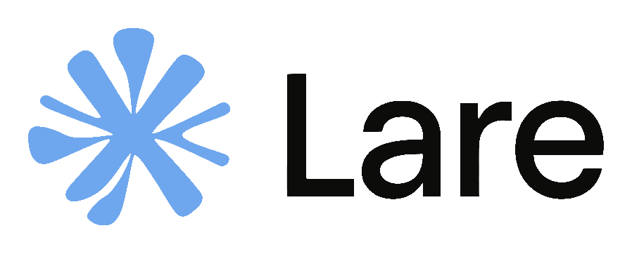

<picture>
  <source media="(prefers-color-scheme: dark)" srcset="brand/wordmark-dark.gif">
  
</picture>

**Social progress tracking for LeetCode.**
Your practice logs itself — every problem opened, every submission judged, with code,
runtime and memory percentiles and the runtime distribution graph.

[Install](#install) · [Architecture](docs/architecture.md) · [Privacy](docs/privacy.md)

---

> **This repository is published so the source can be read, not so it can be built or run.**
> Lare is a hosted service, and building or self-hosting it is not supported: there are no setup,
> build or deployment instructions here, and issues and pull requests are not monitored. To use
> Lare, install a release from the section below.

Share posts with followers, attach demo videos, and run AI-graded mock interviews.

| | |
| --- | --- |
| **Chrome extension** | Captures problems, your Monaco edits and judge results on its own — nothing to start or stop. Starts mock interviews from a side panel. |
| **Desktop app** (Tauri) | Records your screen natively with Cap's recording stack and **transcribes interviews locally with whisper.cpp**. |
| **Website** | A landing page with the downloads. Lare is the app and the extension; there is nothing to sign in to on the web. |

**Mock interviews need the desktop app.** Start one from the extension's side panel while the app
is open: the app records your screen, microphone and camera bubble, whisper.cpp transcribes the
recording on your machine, and the AI review is built from that transcript. Local transcription is
the reason the desktop app exists; it is not going to the cloud.

## Install

Two pieces: the desktop app and the Chrome extension. About two minutes.

### 1. Desktop app

| Platform | Download |
| --- | --- |
| macOS (Apple Silicon, M1 and later) | [Lare-macOS-AppleSilicon.dmg](https://github.com/chaubenn/lare/releases/latest/download/Lare-macOS-AppleSilicon.dmg) |
| macOS (Intel) | [Lare-macOS-Intel.dmg](https://github.com/chaubenn/lare/releases/latest/download/Lare-macOS-Intel.dmg) |
| Windows 10/11 (x64) | [Lare-Windows-x64-Setup.exe](https://github.com/chaubenn/lare/releases/latest/download/Lare-Windows-x64-Setup.exe) |

All versions: [Releases](https://github.com/chaubenn/lare/releases).

- **macOS**: open the DMG, drag Lare to Applications. The build is not notarised yet, so the
  first launch needs right-click > **Open** (or `xattr -dr com.apple.quarantine /Applications/Lare.app`).
  Grant Screen Recording / Camera / Microphone when asked (needed for demo videos and interviews).
- **Windows**: run the installer. If SmartScreen appears, click **More info** > **Run anyway**.

Lare checks GitHub Releases on every launch and installs updates in the background; you can also
run **Settings > Check for updates**.

### 2. Chrome extension

1. Download [Lare-Chrome-Extension.zip](https://github.com/chaubenn/lare/releases/latest/download/Lare-Chrome-Extension.zip) and unzip it.
2. Open `chrome://extensions`, turn on **Developer mode** (top right).
3. Click **Load unpacked** and pick the unzipped folder.
4. Pin the Lare icon and click it to open the side panel, then sign in and open any LeetCode
   problem. Practice starts logging itself immediately.

The extension works on its own for sign-in, passive capture and drafts. It talks to the desktop
app over `127.0.0.1` to start, pause and end a mock interview, so the app has to be open for one
and the desktop footer shows **Extension: connected**. Chrome 116+. Chrome Web Store listing is coming;
until then the unpacked install is the supported path.

## License

AGPL-3.0-only. Portions derived from Cap (AGPL-3.0 / MIT); see [`NOTICE`](NOTICE).
