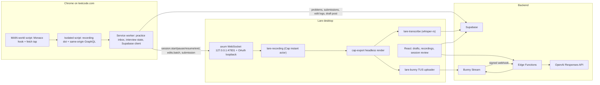

# Lare architecture

Social progress tracking for LeetCode: log practice sessions with a pausable timer, capture submissions (code, runtime
and memory percentiles, the runtime distribution graph), share posts with followers, attach demo
videos, and run AI-graded mock interviews.

## Parts

| Part | Stack | Responsibility |
| --- | --- | --- |
| `apps/extension` | Chrome MV3, WXT, React | Passive practice capture (every problem opened, every submission judged — nothing to start or stop), Monaco edit log, mock-interview start/pause/end sent to the desktop app. On-page UI is one recording dot, shown only while an interview records; the side panel is the control surface. Writes to Supabase directly; talks to the desktop over `ws://127.0.0.1:47831`. |
| `apps/desktop` | Tauri 2, React 19, Rust | Drafts and publishing, screen/camera/mic recording (recycled from Cap), whisper.cpp transcription, Bunny TUS uploads, interview review. |
| `supabase/` | Postgres + RLS, Auth, Storage, Realtime, Edge Functions (Deno) | Source of truth for users, sessions, posts, videos; Bunny signing; OpenAI review. |
| Bunny Stream | library `lare` (id 743884) | Video storage, encoding, delivery. Embed token authentication is on. |

## Data model (Supabase)

- `profiles` (handle, display_name, avatar_url, bio, `is_private`), `follows` (pending/accepted).
- `sessions` (kind practice|interview, scope session|problem, status, `started_at`, `ended_at`,
  `active_ms`, `recording_id`, `recording_started_at`), `session_events` (start/pause/resume/end/
  problem_open/problem_close, wall-clock `t`) - the timer is derived from the event log.
- `session_problems` (slug, title, difficulty, description_html, `edits_path` -> gzip JSON edit log
  in Storage bucket `session-data`), `submissions` (code, verdict, runtime/memory + percentiles,
  distributions).
- `videos` (Bunny guid, status created|uploading|uploaded|processing|ready|failed, dimensions,
  `thumbnail_path` in bucket `thumbnails`), `posts` (draft|published, visibility public|private,
  two video slots — `video_id` + `video_kind` none|full|highlights for the demo/full take and
  `demo_video_id` for an interview's summary clip, each with a `show_*` switch — plus the three
  optional extra the draft editor offers: `include_ai_insights`. (`include_og_card` and `cover_media_id`
  are unused now that posts have no session card or cover; the columns remain.)
  `og_show_ai_scores` is unused — the AI review is a section of the post, not a strip on the card).
- `post_media` (the images an author adds; rows with `kind = 'og'` are leftovers from when the
  session card was a stored PNG and are ignored), `post_likes`, `post_comments`.
- `transcripts` (segments `[{s,e,text}]` in media ms), `interview_reviews` (OpenAI structured output).
- Visibility: `can_view_post` - published and (owner, or public post and (author not private or
  accepted follower)). Child rows inherit through their post; AI insights additionally require
  `include_ai_insights`.

Edge Function configuration lives in Supabase Vault (`public.get_app_secrets`, service role only)
with `Deno.env` taking precedence; see `supabase/functions/_shared/http.ts`.

## Landing page

The landing page is not in this repo. It lives in its own private repo, `chaubenn/lare-landing`,
which Vercel deploys on every push. It is a static page that holds no session and talks to
nothing here beyond linking to this repo's releases.

## Time model

Everything on a session is placed on one **media clock**: milliseconds since
`sessions.recording_started_at` (falling back to `started_at`) **minus the paused stretches**
recorded in `session_events`. The recording skips pauses, so transcript segments and AI moments are
already in media time; edit events (wall-clock epoch from Monaco) and submissions are converted with
`toMediaMs` (`packages/shared/src/timer.ts`, mirrored in `supabase/functions/_shared/edits.ts`).

## Recording pipeline

1. Extension `session.start` (kind interview) or the draft editor's *Record* button.
2. `Recorder` (`apps/desktop/src-tauri/src/recorder.rs`) starts Cap's **instant** actor (single
   MP4; facecam preview window is captured as part of the screen). Overlay windows: recorder pill
   and camera preview.
   Both are built once and thereafter only shown and hidden — the pill's stop button lives inside
   its own webview, and destroying that webview under an in-flight `recording_stop` aborts the
   process. `destroy_overlays` closes them when the main window goes, which is also what quits the
   app now that the overlays outlive every recording.
   A global shortcut (`windows::sync_pill_shortcut`, setting `pillShortcut`, default
   Ctrl+Alt+Shift+H on every platform) hides and shows the pill mid-recording. It is only
   registered between `open_recorder` and `hide_recorder`, so it never claims the key combination
   outside a take, and hiding is just `hide()` — the webview, timer and window position survive.
3. On stop, the `recording:completed` event hands the recording to the React pipeline.
   `stop` and `cancel` are serialised on one mutex and idempotent — the pill's stop button and the
   extension's `session.end` race on every interview ended from the browser, and the second caller
   gets the first one's payload rather than an error. The completed manifest
   (`lare-recording.json`) is written before anything else can fail; if Cap's own stop errors,
   `lare_recording::finalize_project` finishes the take from the fragments on disk instead. The
   same call recovers projects a killed process abandoned (a `lare-started.json` with no completed
   manifest) at the next launch, so they simply turn up in Recordings.
4. `features/recording/pipeline.ts`:
   - instant demo -> `publishVideo` (create Bunny video via `bunny-create-upload`, thumbnail to
     Storage, TUS upload from Rust with progress events, attach to the draft);
   - interview -> transcribe the MP4 with whisper -> upload -> captions (`bunny-captions`) ->
     attach to the session's draft. A failed transcription marks the session ungraded and the
     video still uploads.
5. Bunny calls `bunny-webhook` (HMAC) as it encodes; `videos.status` flips to `ready` and the app
   and desktop players pick it up over Realtime. Playback URLs come from `bunny-playback-token`
   after an RLS visibility check.

The recorder reports `recordedMs` — wall clock less every paused stretch — with each state and
completed payload, so the pill's timer counts the video rather than the sitting.

Bookkeeping for resumable pipelines is in the Tauri store (`recordings.json`), surfaced on the
Recordings page. It also records which of the post's two video slots a take was started for — the
recorder manifest only carries the post id.

## Post carousel

Two decks, one mechanism. `PostCarousel` is the swipe deck itself — native scroll-snap for the
swiping, arrows and dots for pointer users — and both the feed and the post page compose their own
slides into it.

The feed's deck, `apps/desktop/src/features/feed/PostSlides.tsx`:

    summary video -> images -> demo/full video

Every slide is something the author chose to add. Images are optional: paste a screenshot, drop
files on the Images panel, or pick them from the machine (the main window sets
`dragDropEnabled: false` so file drops reach the page instead of Tauri). A post with no images and
no video has no deck at all (`postHasSlides`) and the card is just its text. One clip and no images
is a deck of one slide, the video.

The post page builds its own in `PostPage.tsx`, deliberately narrower:

    summary video -> images -> demo/highlights video -> problems -> AI review

The problems and the review are slides rather than sections down the page, which is what keeps the
comments a fixed distance from the title however much a session holds.

Both decks size their frame to the slide in view (`PostCarousel` measures the current slide with a
`ResizeObserver`, because "Show code" and the problem description collapsible change height on
their own). Videos and images take their own shape from the stored `width`/`height` (`mediaAspect`,
clamped to 4:5 .. 12:5), so a 16:10 screen recording has no bars around it; a clip with no stored
size falls back to 16:9. When a post carries both clips, `LabelledSlide` names them in the corner —
the player's `title` only ever reached screen readers.

There is no generated session card or session-overview slide any more. They were drawn from the
session (and, before that, rendered to a PNG for link unfurls); a post now carries only what its
author attaches.

## Licensing

`crates/vendor/cap/*` is vendored from [Cap](https://github.com/CapSoftware/Cap) (AGPL-3.0, with the
`cap-camera*`/`scap-*` crates under MIT); Lare is therefore AGPL-3.0-only. See `NOTICE`.
