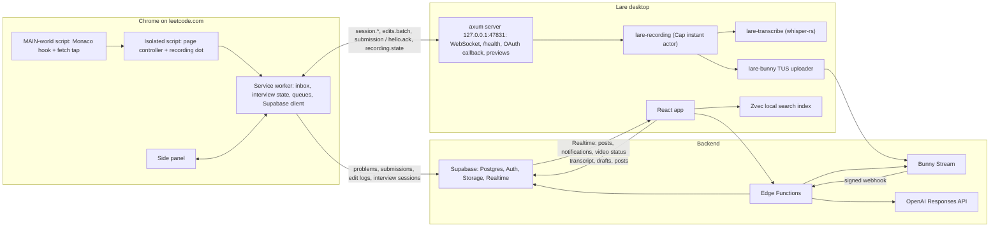

# Lare architecture

Social progress tracking for LeetCode. The Chrome extension logs practice on its own, the desktop
app records and transcribes mock interviews, and Supabase holds everything people share: posts with
demo videos, follows, likes, comments, leaderboards, and AI-graded interview reviews.

Current release: 3.4.x (desktop and extension are versioned together).

- [Parts](#parts)
- [How the pieces talk](#how-the-pieces-talk)
- [What gets captured](#what-gets-captured)
- [Extension ↔ desktop protocol](#extension--desktop-protocol)
- [Data model](#data-model-supabase)
- [Access rules](#access-rules)
- [Edge Functions](#edge-functions)
- [Time model](#time-model)
- [Recording pipeline](#recording-pipeline)
- [Desktop app](#desktop-app)
- [Post carousel](#post-carousel)
- [Website](#website)
- [Build, CI and releases](#build-ci-and-releases)
- [Licensing](#licensing)

## Parts

| Part | Stack | Responsibility |
| --- | --- | --- |
| `apps/extension` | Chrome MV3, WXT, React | Passive capture of every LeetCode problem opened and every submission judged, plus the Monaco edit log. Side panel (tabs: *Tracking*, *Mock interview*) is the control surface; the only on-page UI is a recording dot while an interview records. Signs in and writes to Supabase directly. Starts, pauses and ends interviews on the desktop over a loopback WebSocket. Chrome 116+. |
| `apps/desktop` | Tauri 2, React 19, Rust | The main app: feed, drafts, sessions, profiles, leaderboards, notifications, settings. Records screen, camera and mic (Cap's stack), transcribes with whisper.cpp, uploads to Bunny over TUS, runs the local server the extension talks to, and self-updates. |
| `supabase/` | Postgres + RLS, Auth, Storage, Realtime, Edge Functions (Deno) | Source of truth. Also Bunny signing and the OpenAI review. |
| Bunny Stream | library `lare` (id 743884) | Video storage, encoding and delivery. Embed token authentication is on. |
| `packages/shared` | TypeScript | Types and pure logic used by both clients: wire protocol, timer and time model, edit log, LeetCode parsing, formatting, goals and leaderboard maths, search doc shapes, AI review schema. |
| `packages/ui` | React, Tailwind | Design tokens, icons, motion and the shared components (activity and runtime charts, code block, badges). |
| `packages/supabase-types` | generated | `database.types.ts`. |
| `packages/capture` | TypeScript | Browser MediaRecorder capture with resumable TUS upload, from when the website and extension recorded video. Nothing imports it now; the desktop app records instead. |
| `crates/lare-core` | Rust | Protocol and edit-log types mirrored from `packages/shared`; the port and `PROTOCOL_VERSION`. |
| `crates/lare-recording` | Rust | Facade over Cap: devices, permissions, instant recording, the live fragment muxer, crash recovery. See its README. |
| `crates/lare-transcribe` | Rust | whisper.cpp wrapper and resumable model download. |
| `crates/lare-bunny` | Rust | TUS uploader, including uploading a file while it is still growing. |
| `crates/vendor/cap/*` | Rust | Vendored [Cap](https://github.com/CapSoftware/Cap) crates (`UPSTREAM_COMMIT`, `CHANGES.md`, resync with `scripts/sync-cap.sh`). |

## How the pieces talk

Three rules hold the design together:

1. **The extension never needs the desktop for practice.** Sign-in, passive capture and publishing
   tracked problems all go straight to Supabase. The desktop is required only for mock interviews,
   which need recording and local transcription.
2. **Speech never leaves the machine.** Audio is transcribed by whisper.cpp on the device; only the
   text is stored.
3. **Clients are untrusted.** Everything that matters (visibility, ownership, counters, timestamps,
   the leaderboard) is enforced by RLS, triggers and RPCs in the database. See
   [Access rules](#access-rules).

## What gets captured

### Practice: passive, no timer

There is nothing to start or stop. The MAIN-world script taps Monaco and `fetch`; the isolated
script (`pageController.ts`) reports each problem opened and each judged submission to the service
worker, which writes them to the user's **practice inbox**.

- The inbox is one long-lived `sessions` row per user (`is_practice_inbox`, always `active`, never
  has a post), created on first use by `practice_inbox()`. Its problems and submissions live in
  `session_problems` and `submissions` like any other session, so all existing RLS applies.
- The desktop shows the inbox as **Tracked problems** at the top of Drafts. Publishing a selection
  calls `publish_practice_problems(problem_ids, title)`, which mints a fresh session and a draft
  post and *moves* the problems onto it. A problem leaving the inbox is what "posted" means; there
  is no flag.
- `delete_practice_post(post_id)` is the inverse: problems return to the inbox, then the post and
  its session are deleted. It only accepts posts made this way (`sessions.client = 'inbox'`);
  interviews and older practice posts use a plain delete.
- Submissions that cannot be saved (offline, Supabase down) wait in a persisted queue in
  `chrome.storage` (`src/queues.ts`, oldest dropped past 50) and are flushed by the service worker.
  Edit events are buffered in IndexedDB (`editsDb.ts`) and uploaded as one gzip JSON file per
  problem to the `session-data` bucket.
- A two-minute alarm reconciles state after a service worker restart. Writes are upserts keyed by
  client-generated UUIDs so retries never duplicate rows.

### Mock interviews: explicit, timed, recorded

Started from the side panel's *Mock interview* tab:

1. Connect to the desktop and require a `hello.ack` for the same account with
   `recordingCapable: true`; otherwise the panel names the blocker.
2. Create the session and problem rows, show the red dot, send `session.start`, wait for the
   desktop's `recording.state` (`recording`, or `error` with a message).
3. Pause, resume, end or discard map to `session.pause`, `session.resume`, `session.end`,
   `session.cancel`. The same controls exist on the desktop's recording pill. Closing or fully
   navigating the recorded tab ends the interview; SPA problem changes keep the dot.
4. The desktop stops, transcribes locally and uploads. The extension finalizes the session
   (`finalizeSession`) and creates the draft post. The AI review is generated on demand from the
   session page.

## Extension ↔ desktop protocol

Server: `apps/desktop/src-tauri/src/ws_server.rs`, bound to `127.0.0.1:47831`. Types live in
`packages/shared/src/session/protocol.ts` and `crates/lare-core/src/protocol.rs`; **keep the two in
sync and bump `PROTOCOL_VERSION` whenever either side starts relying on something the other's
previous release does not do.**

| Route | Purpose |
| --- | --- |
| `GET /` (WebSocket) | The extension's channel. Only the pinned extension origin (and the Chrome Web Store id, if configured) may upgrade in release builds. |
| `GET /health` | `{"app":"lare",...}`, readable from any page. Says the app is running and nothing about who is signed in. |
| `GET /auth/callback` | OAuth loopback redirect; forwards the PKCE `code` to the webview. |
| `GET /preview/{token}` | This device's copy of a recording, for the local preview. |

Protocol version is **3**; the app still serves extensions back to 2 by answering `hello` with the
lower of the two versions.

| Extension → app | App → extension |
| --- | --- |
| `hello` (protocol, version, `userId`) | `hello.ack` (protocol, app version, `userId`, `recordingCapable`, `recording` snapshot) |
| `session.start / pause / resume / end / cancel` | `recording.state` (`idle` ... `recording`, `paused`, `stopping`, `error`; optional message) |
| `problem.open`, `edits.batch`, `submission` | `error` (`not_signed_in`, `user_mismatch`, `permission_denied`, `already_recording`, `recording_failed`, `bad_message`, `unsupported_protocol`) |
| `ping` | `pong` |

`session.*` frames only act on the session they name. `hello.ack.recording` lets an extension that
reconnects mid-interview catch up on what it missed. Frames sent while the app is unreachable wait
in the extension's `lare:desktop-outbox`.

## Data model (Supabase)

Migrations are `supabase/migrations/0001` onwards, all idempotent, applied by hand in the SQL
Editor in number order (see "Writing migrations" below). Types are generated into
`packages/supabase-types`.

**People and social**
- `profiles` (handle, display_name, avatar_url, bio, website, `is_private`).
- `follows` (`pending` | `accepted`), changed only through `request_follow`, `accept_follow`,
  `decline_follow`, `remove_follower`. `follow_list` pages followers and following.
- `post_likes` (`toggle_post_like`), `post_comments` (threaded via `parent_id`, with `edited_at`),
  `notifications` (`post_like`, `post_comment`, `comment_reply`, `comment_mention`, `follow`,
  `follow_request`, `follow_accepted`). Notifications are written by triggers only and read with
  `mark_notifications_read`.

**Practice and interviews**
- `sessions`: `kind` practice|interview, `scope` session|problem, `status`
  active|paused|ended|abandoned, `started_at`, `ended_at`, `active_ms`, `graded`, `client`,
  `is_practice_inbox`, `recording_id`, `recording_started_at`.
- `session_events` (start/pause/resume/end/problem_open/problem_close with wall-clock `t`). The
  interview timer is derived from this log.
- `session_problems` (slug, title, difficulty, `topic_tags`, description_html, `edits_path` → gzip
  JSON edit log in bucket `session-data`), `submissions` (code, verdict, runtime/memory with
  percentiles and distributions, `leetcode_submission_id`).
- `transcripts` (segments `[{s,e,text}]` in media ms; `upsert_transcript_segments`),
  `interview_reviews` (OpenAI structured output: scores, moments, next steps, code iterations),
  `review_criteria` (a user's own grading criteria; no row means the defaults in
  `packages/shared`), `usage_ledger` (append-only ledger behind every daily limit, 0034;
  `ai_review_usage` is its read-only predecessor).
- `practice_goals` (one private goal per user: N problems per day or week, optional minimum
  difficulty) with `goal_progress()`.

**Posts and media**
- `posts` (`draft` | `published`, visibility public|private, `slug`, title, body, counters). Two
  video slots: `video_id` + `video_kind` (none|full|highlights) for the demo or full take, and
  `demo_video_id` for an interview's summary clip, each with a `show_*` switch. `include_ai_insights`
  controls whether the AI review is shown. `include_og_card`, `cover_media_id` and
  `og_show_ai_scores` are unused (posts have no session card or cover now); the columns remain.
- `post_media` (images an author adds; rows with `kind = 'og'` are leftovers from the old stored
  session card and are ignored).
- `videos` (Bunny guid, status created|uploading|uploaded|processing|ready|failed, dimensions,
  `capture_source`, `thumbnail_path` in bucket `thumbnails`). The `studio` value of the `video_mode`
  enum is a leftover from the removed studio editor.

**Read APIs (security definer RPCs, because `submissions` is owner-only under RLS)**
`feed(before, page_size, scope, before_id)` (keyset on `(published_at, id)`, scope `all` | `following`),
`profile_stats`, `solved_activity`, `solved_skills`, `weekly_leaderboard` (viewer plus accepted
followees), `global_leaderboard` (everyone, with the viewer's own row).

**Lifecycle RPCs**
`practice_inbox`, `publish_practice_problems`, `delete_practice_post`, `create_session_draft`
(gives a finished session a fresh draft, built the way the extension builds one),
`unpublish_post`, `claim_usage` (service role only; `claim_ai_review_slot` is a wrapper kept for
older `ai-review` deployments).

Edge Function configuration lives in Supabase Vault (`public.get_app_secrets`, service role only)
with `Deno.env` taking precedence; see `supabase/functions/_shared/http.ts`.

## Access rules

Visibility is decided once, in `private.can_view_post_as(post, viewer)` (0035), and everything else
inherits it. `can_view_post`, `can_view_profile_content` and `is_accepted_follower` are wrappers that
pass `auth.uid()`; `user_can_view_post` asks on behalf of a notification's recipient.

- **Post visible** = published, and (owner, or public post and (author not private, or viewer is an
  accepted follower)).
- **Pending posts (0018).** An author can publish while a video is still processing. Others see the
  post only once every video it *shows* is `ready`; at that moment `published_at` moves to now so it
  lands at the top of feeds. There is no `pending` status. A hidden video never holds a post back.
- **A post goes live once (0033).** `post_first_live` (server only) records the `published_at` a
  post had the first time it was live. Only a post that has never been live is moved to now when its
  video becomes ready, and publishing a post again after `unpublish_post` restores that first
  `published_at`. So neither a new video nor unpublishing and publishing again can bump a post.
- **Hidden means hidden (0019).** A video switched off with `show_video` / `show_demo_video` is
  invisible to viewers in the database, not just the UI, so it cannot be fetched or given a
  playback token. Authors still see their own.
- **Children inherit.** Sessions, problems, submissions, videos, thumbnails, comments, likes and
  media are visible through the post that references them. The transcript and AI review also need
  `include_ai_insights`.
- **Posts only reference what the author owns (0020)**: session, videos and cover.
- **Server-owned columns (0026).** `like_count`, `comment_count`, `published_at`, `slug`, `user_id`,
  `session_id`, `created_at` cannot be written by `anon` or `authenticated`. Re-publishing never bumps
  a post. One compatibility case remains: a plain update from `published` to `draft` keeps the post
  published, because extensions released before 3.5.0 (bridge protocol 2) upsert `status: 'draft'`
  on a finalize retry, and installed desktop builds whose `MIN_EXT_PROTOCOL_VERSION` is 2 still run
  interviews for them. Current extensions never send `status`, and unpublishing goes through
  `unpublish_post`. The case can go once no desktop build that accepts protocol 2 is in use; the
  database cannot tell old clients apart, so dropping it earlier would silently unpublish posts
  again.
- **Video state is Bunny's (0033).** For `anon` and `authenticated`, `videos.status` only moves
  `created -> uploading` (a late `uploading` from an older desktop is ignored, anything else is
  refused), `error` is refused, and `duration_ms` / `width` / `height` are provisional until the video
  is ready, then pinned. `ready_at` is stamped by the database the first time a video is ready.
- **Comment edits follow visibility (0035)**: editing a comment needs the post to be visible, like
  writing one.
- **Follow edges are immutable (0027)** apart from `pending → accepted`, and only via the RPCs.
- **Private accounts** show only their header (name, picture, handle) to everyone but accepted
  followers, including signed-out viewers (0024: the helper always returns a real boolean, and the
  RPCs test `is not true`, so a null can only hide content). The global leaderboard lists them with
  just a weekly count and difficulty split.
- **Leaderboard integrity (0028).** `submissions.created_at` is server-stamped; boards only count
  accepted submissions that carry a LeetCode id, arrived within two days of `submitted_at`, and have
  a plausible slug, capped at 30 distinct problems per user per UTC day. This is mitigation, not
  proof: a determined user can still script plausible inserts.
- **Storage paths stay owned (0031).** Every path column (`session_problems.edits_path`,
  `videos.thumbnail_path`, `post_media.storage_path`) must pass `private.is_owned_storage_path`: the
  first segment is the row owner's id and no segment is empty, `.` or `..` or has a backslash.
  Thumbnails are exactly `{owner}/{video_id}.{ext}` and photos `{owner}/{post_id}/{file}`. Edge
  Functions check the same rule (`_shared/storage.ts`) before any service-role storage call, since
  the service role ignores storage policies. The read policies of `thumbnails` and `post-media` also
  require the object to sit in the owning row's folder.
- **Usage limits (0034).** Per user per rolling 24 hours, claimed in `usage_ledger` under an advisory
  lock before the work happens: 5 AI reviews (before OpenAI is called), 50 new videos (before Bunny
  is), 100 comments (refused past it) and 50 mention notifications (past it, comments still post but
  stop notifying).

## Edge Functions

| Function | Caller | What it does |
| --- | --- | --- |
| `bunny-create-upload` | desktop | Creates the Bunny video and our `videos` row; returns TUS credentials so clients upload straight to Bunny without seeing the API key. 50 per user per day (`usage_ledger`). |
| `bunny-finalize-recording` | desktop | Receipt confirmation only. The client must finish the deferred TUS upload first. |
| `bunny-captions` | desktop | Owner-only. Attaches the whisper transcript as a WebVTT track. |
| `bunny-webhook` | Bunny | HMAC-signed (`verify_jwt = false`, auth is the signature). Flips `videos.status`, which releases pending posts. |
| `bunny-playback-token` | desktop, website | `{videoId}` → signed embed URL valid five minutes. Authorisation is whatever RLS lets the caller select, so it works for anonymous viewers of public posts and refuses hidden clips. |
| `video-delete` | desktop | Owner-only. Deletes the Bunny video, the thumbnail and the row; clears `video_kind` on posts that pointed at it. |
| `ai-review` | desktop session page | `{sessionId, force?}`. Builds a timeline from the transcript, Monaco edit checkpoints and submissions, applies the user's `review_criteria`, asks OpenAI (Responses API, strict JSON schema, `gpt-5-mini` unless `OPENAI_MODEL` is set), and upserts `interview_reviews`. |

Shared helpers are in `functions/_shared` (`http.ts`, `bunny.ts`, `edits.ts`, `reviewCriteria.ts`,
`aiReviewSchema.ts`, `storage.ts`). Service-role code loads the caller's rows through `ownedRow`
(`supabase.ts`), which puts `user_id` in the query and answers 404 for anyone else's row.
`ai-review` passes the user's `review_criteria` in the user message inside `<grading_preferences>`
and tells the model to treat it as preferences, never as instructions about scores. Errors from
OpenAI and the database go to the function logs, not to the caller. Tests: `functions/_tests`,
`bunny_test.ts`.

### Settings outside the repo

There is no `supabase/config.toml`; functions are deployed with `npx supabase functions deploy`
from a local terminal, and these settings live in the Supabase dashboard. Check them after creating a
project or changing a function:

- **JWT verification per function.** `bunny-webhook` must be deployed with JWT verification off
  (`--no-verify-jwt`): Bunny sends no JWT and the function authenticates the HMAC signature instead.
  Every other function checks the caller itself (`requireUser` / `optionalUser`), so it is safe
  either way, but `bunny-playback-token` serves signed-out viewers of public posts: if verification
  is on for it, the key the website and app send must pass the gateway.
- **Exposed API schemas** (API settings): `public` (and `graphql_public`) only. `private` must never
  be exposed; its functions assume they are reached only through policies and definer code (0036).
- **Auth redirect URLs**: `http://127.0.0.1:47831/auth/callback` (desktop) and
  `https://<extension id>.chromiumapp.org/auth/callback` for each extension id (see "Build, CI and
  releases").
- **Bunny webhook** points at `.../functions/v1/bunny-webhook`. Bunny signs only the body, with the
  library's read-only API key, and sends no timestamp, so a captured call can be replayed. The damage
  is bounded: a replay can re-apply a status to a video that is not ready yet (the next real event
  corrects it), never regresses a ready video, and cannot move `ready_at` (0033).

### Writing migrations

- New file, next number, idempotent (`create or replace`, `drop ... if exists`, `on conflict do
  nothing`), safe on a live database with existing rows (check new rules with triggers on insert and
  update, or `not valid` constraints, rather than rewriting old rows).
- Security definer functions: `set search_path = ''` and schema-qualify every name. Older ones use
  `public`, which is safe only because the API roles cannot create objects there (0036).
- A function the API roles should not call: `revoke all ... from public, anon, authenticated`. In
  `private`, end the migration with `select private.sync_function_privileges();`, which closes every
  private function and grants EXECUTE back only on those a policy calls.

## Time model

Everything on a session is placed on one **media clock**: milliseconds since
`sessions.recording_started_at` (falling back to `started_at`) **minus the paused stretches**
recorded in `session_events`. The recording skips pauses, so transcript segments and AI moments are
already in media time; edit events (wall-clock epoch from Monaco) and submissions are converted with
`toMediaMs` (`packages/shared/src/session/timer.ts`, mirrored in
`supabase/functions/_shared/edits.ts`).

## Recording pipeline

1. Start: the extension's `session.start` (interview), the desktop pill, or the draft editor's
   *Record* button (demo or summary clip).
2. `Recorder` (`apps/desktop/src-tauri/src/recorder.rs`) starts Cap's **instant** actor (single MP4;
   the facecam preview window is captured as part of the screen). Two overlay windows, the recorder
   pill and the camera preview, are built once and thereafter only shown and hidden: the pill's stop
   button lives inside its own webview, and destroying that webview under an in-flight
   `recording_stop` aborts the process. `destroy_overlays` closes them when the main window goes,
   which is also what quits the app.
   A global shortcut (`windows::sync_pill_shortcut`, setting `pillShortcut`, default
   Ctrl+Alt+Shift+H on every platform) hides and shows the pill mid-recording. It is registered only
   between `open_recorder` and `hide_recorder`, so it never claims the keys outside a take.
3. Stop: the `recording:completed` event hands the take to the React pipeline.
   `stop` and `cancel` are serialised on one mutex and idempotent: the pill's stop button and the
   extension's `session.end` race on every interview ended from the browser, and the second caller
   gets the first one's payload rather than an error. The manifest (`lare-recording.json`) is
   written before anything else can fail; if Cap's own stop errors,
   `lare_recording::finalize_project` finishes the take from the fragments on disk.
4. `features/media/pipeline.ts`:
   - **demo or summary clip** → `publishVideo`: create the Bunny video (`bunny-create-upload`),
     thumbnail to Storage, TUS upload from Rust with progress events, attach to the draft.
     These start with a prepared target (`prepare_bunny_upload`), so the upload tails the growing
     file *while recording* and only the last fragments remain at stop.
   - **interview** → `processInterview`: transcribe the MP4 with whisper → store the transcript →
     upload the finished MP4 → captions (`bunny-captions`) → attach to the session's draft. A failed
     transcription marks the session ungraded and the video still uploads.
5. Bunny calls `bunny-webhook` as it encodes; `videos.status` flips to `ready` and the app picks it
   up over Realtime. Playback URLs come from `bunny-playback-token`.

The recorder reports `recordedMs` (wall clock less every paused stretch) with each state and
completed payload, so the pill's timer counts the video rather than the sitting.

### Recovery

- **Killed process.** A `lare-started.json` with no completed manifest is finished at the next
  launch (`recover_incomplete`), so the take turns up like any other.
- **Unfinished interviews.** `features/media/recovery.ts` lists interview takes on this device that
  never finished uploading (quit mid-interview, crash, expired upload). The Sessions page and the
  session page show them with **Retry** (resumes the pipeline; finished steps are skipped) and
  **Discard** (deletes the take and its half-uploaded `videos` row).
- **Failed transcription.** The session page offers **Retry transcription** or **Keep as video
  only**.
- **Local copies.** Recordings stay on disk after upload and play as a local preview until their
  video is `ready`; `localCopies.ts` then deletes them (on launch, on the Realtime ready event, and
  every five minutes). Failed uploads keep their source for retry.
- Bookkeeping for resumable pipelines is in the Tauri store (`recordings.json`), including which of
  the post's two video slots a take was started for, since the recorder manifest only carries the
  post id. There is no Recordings page; takes surface in the draft's media step, the session page
  and the unfinished-interviews card.

## Desktop app

Routes (`router.tsx`): Feed `/`, post `/posts/:id` and `/posts/:id/edit`, Drafts `/drafts` and
`/drafts/:id`, Sessions `/sessions` and `/sessions/:id`, Profile `/profile`, `/profile/edit`,
`/u/:handle`, Friends `/friends` (requests are a tab), Leaderboard (friends and global),
Notifications, Settings. Code is organised per feature under `src/features/*`; data comes from
Supabase through TanStack Query with Realtime channels for posts, notifications and video status.

Other things that live in the Rust shell:

- **Command palette search.** `search.rs` keeps one [Zvec](https://crates.io/crates/zvec-rust)
  collection per signed-in user (sessions, what was said in interviews, posts, drafts, people),
  filled by `features/search/sync.ts`. Short documents match on 2–3 character n-grams so partial
  words find results while typing; transcripts and reviews match on stemmed whole words. A CPU
  without AVX never loads the library and the palette falls back to substring search.
- **Sign-in.** OAuth (GitHub, Google) with PKCE in the system browser, redirected to the loopback
  server. `current_user` is mirrored into `hello.ack.userId`, and the extension refuses to start an interview when it names a different account.
- **Deep links.** `lare://open/<path>` and `lare://drafts/<id>` route inside the app; the
  single-instance plugin hands a second launch's link to the running one.
- **Updates.** Checks GitHub Releases on every launch and installs before opening, then hourly, and on
  demand from Settings.
- **Whisper models.** `ggml-small.en` by default, fetched from the project's own release mirror
  (`publish-models.yml`) with resumable chunked download, falling back to Hugging Face.
- **Logs.** `~/Library/Logs/Lare` on macOS, `%LOCALAPPDATA%\Lare\logs` on Windows, user-only
  permissions.

## Post carousel

Two decks, one mechanism. `PostCarousel` is the swipe deck itself (native scroll-snap for swiping,
arrows and dots for pointer users); the feed and the post page each compose their own slides into it.

The feed's deck, `apps/desktop/src/features/feed/PostSlides.tsx`:

    summary video -> images -> demo/full video

Every slide is something the author chose to add. Images are optional: paste a screenshot, drop
files on the Images panel, or pick them from the machine (the main window sets
`dragDropEnabled: false` so file drops reach the page instead of Tauri). A post with no images and
no video has no deck at all (`postHasSlides`) and the card is just its text. One clip and no images
is a deck of one slide.

The post page builds its own in `PostPage.tsx`, deliberately narrower:

    summary video -> images -> demo/highlights video -> problems -> AI review

The problems and the review are slides rather than sections down the page, which keeps the comments
a fixed distance from the title however much a session holds.

Both decks size their frame to the slide in view (`PostCarousel` measures the current slide with a
`ResizeObserver`, because "Show code" and the problem description collapsible change height on
their own). Videos and images take their shape from the stored `width`/`height` (`mediaAspect`,
clamped to 4:5 .. 12:5); a clip with no stored size falls back to 16:9. When a post carries both
clips, `LabelledSlide` names them in the corner.

There is no generated session card or session-overview slide any more; a post carries only what its
author attaches.

## Website

The website is not in this repo. This repo only knows its address, `https://lare.fyi`, set in CI as `VITE_SITE_URL` (desktop) and `WXT_SITE_URL` (extension).

- The desktop's **Copy link** (`postActions.ts`, `SHARE_LINKS`) produces `lare.fyi/p/<slug>`. The
  slug is the canonical handle (`0012_post_slugs.sql`); the site also resolves the UUID and
  redirects.
- Public post pages are served from public data: RLS lets anonymous viewers read public posts, and
  `bunny-playback-token` gives them signed embeds.
- It links to this project's releases for downloads.

## Build, CI and releases

Workspace: pnpm (Node 22+) for TypeScript, Cargo (edition 2024) for Rust, Biome for lint and format.
Per-app checks are in `apps/desktop/README.md` and `apps/extension/README.md`.

| Workflow | Trigger | Purpose |
| --- | --- | --- |
| `ci-dev.yml` | push to `dev` | Fast lane: format, types, unit tests. |
| `ci.yml` | push and PR to `main` | Full gate: Rust on macOS and Windows, extension Playwright e2e. |
| `prebuild.yml` | push to `main` | Builds desktop installers for every `main` commit (via `desktop-build.yml`) so a release is a publish, not a compile. |
| `release.yml` | tag `vX.Y.Z` | Publishes signed, notarised installers and updater bundles (macOS Apple Silicon and Intel, Windows x64), the extension zip, and `latest.json`. Falls back to compiling if the commit was never prebuilt. |
| `dev-release.yml` | tag `dev-vX.Y.Z-N[-targets]` | QA prerelease straight from `dev`; never becomes "latest", so no installed app updates onto it. |
| `publish-models.yml` | change on `main`, manual | Mirrors the whisper models to a GitHub release. |

Development happens in a private repo. `scripts/publish-release.sh` publishes the exact tree as one
release commit to the public repo, whose history is releases only. The public repo is for reading,
not building (see the README).

The Chrome Web Store package is built without the pinned `key` (`pnpm zip:store`, `LARE_STORE_BUILD`),
so the store assigns its own extension id (`anlejcjfgabfkgbhbcbojlmccagbfdhg`). The desktop's origin
allow-list includes it (`STORE_EXTENSION_ID` in `ws_server.rs`; `LARE_STORE_EXTENSION_ID` overrides it
at build time), and Supabase Auth needs `https://<that id>.chromiumapp.org/auth/callback` in its
redirect URLs for sign-in. If the redirect URL is missing, Supabase falls back to the Site URL, so the
GitHub/Google popup lands on the landing page instead of returning to the extension. Email sign-in
(desktop and extension) uses a 6-digit code via `signInWithOtp` + `verifyOtp`, so the Supabase "Magic Link"
and "Confirm signup" email templates must include `{{ .Token }}`; a link-only template sends a magic link
and there is no code to type.

## Licensing

`crates/vendor/cap/*` is vendored from [Cap](https://github.com/CapSoftware/Cap) (AGPL-3.0, with the
`cap-camera*`/`scap-*` crates under MIT); Lare is therefore AGPL-3.0-only. See `NOTICE`.

## Related docs

- [`docs/privacy.md`](privacy.md): consent and data-flow rules the product follows.
- [`docs/privacy-policy.md`](privacy-policy.md): the policy for the app and the extension.
- [`crates/lare-recording/README.md`](../crates/lare-recording/README.md): the live muxer, its
  completion and recovery rules, and its limits.
- [`docs/deferred/studio.md`](deferred/studio.md): the removed studio editor and how to restore it.
